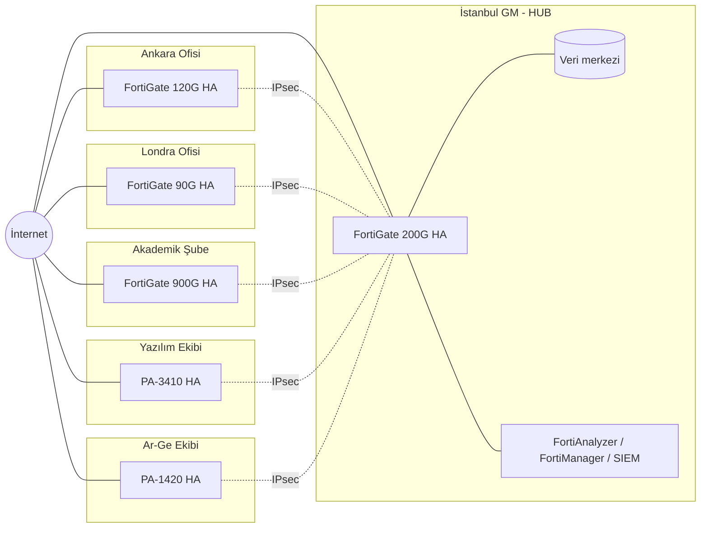

# 01 — Şirket Yapısı ve Ağ Topolojisi

## 1. Birimler ve kadro

| Birim | Konum | Görev | Kadro dağılımı |
|---|---|---|---|
| İstanbul Genel Merkez | İstanbul | Yönetim, finans, İK, hukuk, satış; şirket veri merkezi (AD, ERP, dosya, yedekleme) ve VPN hub | 300 personel, 25 IT/teknik |
| Ankara Ofisi | Ankara | Kamu ilişkileri, ihale, bölge satış; Ar-Ge'ye yakın destek | 140 personel, 10 IT/teknik |
| Londra Ofisi | Londra | UK/AB operasyonları, iş geliştirme | 75 personel, 5 IT/teknik |
| Akademik Şube | İstanbul kampüs | Eğitim ve öğretim | 10.000 öğrenci, 600 akademisyen, 400 idari personel, 40 IT/teknik |
| Yazılım Ekibi | İstanbul teknopark binası | Ürün geliştirme, CI/CD, bulut operasyonları | 120 geliştirici, 15 DevOps, 15 QA/teknik |
| Ar-Ge Ekibi | Ankara teknokent binası | Araştırma, prototip, laboratuvar, veri/GPU işleri | 60 araştırmacı (55 araştırmacı + 5 laboratuvar), 10 teknik |

## 2. IP adres planı

| Birim | Ana blok | Not |
|---|---|---|
| İstanbul GM | 10.10.0.0/16 | Veri merkezi sunucuları 10.10.40.0/22 |
| Ankara | 10.20.0.0/16 | |
| Londra | 10.30.0.0/16 | |
| Akademik — personel/akademik/sunucu | 10.40.0.0/16 | |
| Akademik — öğrenci kablosuz | 10.100.0.0/16 | Bina başına /20 (4.094 adres); 10.000 öğrenci × ~2 cihaz |
| Yazılım | 10.50.0.0/16 | |
| Ar-Ge | 10.60.0.0/16 | Laboratuvar 10.60.100.0/24 internete kapalı |
| Bant dışı yönetim (OOB) | 10.250.0.0/16 | Her birime bir /24 (ör. İstanbul 10.250.10.0/24) |

## 3. Ortak VLAN şablonu

Her birimde aynı numaralandırma kullanılır, böylece kural setleri ve izleme panoları tutarlı olur.

| VLAN | Ad | Örnek (İstanbul) | Açıklama |
|---:|---|---|---|
| 10 | MGMT | 10.250.10.0/24 | Ağ cihazı yönetimi, yalnızca IT jump sunucusundan erişim |
| 20 | PERSONEL | 10.10.20.0/23 | Kablolu + kurumsal kablosuz (802.1X) |
| 30 | IT | 10.10.30.0/24 | IT ekibi, yönetim araçları |
| 40 | SUNUCU | 10.10.40.0/22 | AD/DNS, ERP, dosya, yedekleme |
| 50 | VOIP | 10.10.50.0/24 | IP telefonlar |
| 60 | YAZICI_IOT | 10.10.60.0/24 | Yazıcı, kamera, kartlı geçiş |
| 70 | MISAFIR | 10.10.70.0/23 | Yalnızca internet, captive portal |
| 80 | DMZ | 10.10.80.0/24 | Dışa açık servisler (reverse proxy/WAF) |
| 99 | KARANTINA | 10.10.99.0/24 | NAC'ın uyumsuz cihazları attığı VLAN |

Birime özel ek VLAN'lar (Akademik: öğrenci, akademisyen, laboratuvar, sınav, kütüphane; Yazılım: DEV, CI/CD, STAGING; Ar-Ge: araştırma, izole lab, GPU/veri) ilgili klasörlerde tanımlıdır.

## 4. Güvenlik bölgeleri (zone) ve güven seviyeleri

| Zone | Güven | Kural |
|---|---|---|
| UNTRUST (internet) | 0 | Hiçbir şey içeri giremez, yalnızca DMZ'de yayınlanan servisler |
| MISAFIR / OGRENCI | 10 | Yalnızca internet ve izinli kampüs servisleri |
| YAZICI_IOT | 20 | Yalnızca kendi yönetim sunucusuyla konuşur |
| DMZ | 30 | İç ağa yalnızca tanımlı uygulama portlarıyla |
| PERSONEL / VOIP | 50 | Uygulama bazlı izinlerle sunuculara |
| DEV / ARGE | 60 | Ayrı iç güvenlik duvarı arkasında |
| SUNUCU | 80 | En sıkı korunan iç alan |
| MGMT | 100 | Yalnızca yetkili yöneticiler, MFA ile |

## 5. Topoloji

- Her lokasyonda **iki farklı operatörden** internet hattı; SD-WAN ile performans bazlı yol seçimi.
- Her lokasyonda güvenlik duvarları **aktif-pasif HA** çiftidir (Akademik Şube'de oturum senkronizasyonu zorunlu).
- **Felaket kurtarma:** İstanbul GM hub'ı devre dışı kalırsa şubeler Ankara FortiGate'ini ikincil hub olarak kullanır (ikincil IPsec tünelleri hazır bekler).
- **Uzaktan erişim:** SSL-VPN yerine IPsec/IKEv2 istemci VPN veya ZTNA + MFA.

## 6. Mevzuat ve uyum çerçevesi

| Konu | Uygulandığı birim | Firewall'a etkisi |
|---|---|---|
| 5651 sayılı Kanun / Toplu Kullanım Sağlayıcı Yönetmeliği | Akademik Şube (öğrenci/misafir ağı), tüm misafir ağları | Erişim kayıtları 2 yıl saklanır; suç teşkil eden içeriğe erişimi önleyici filtreleme |
| KVKK | Türkiye'deki tüm birimler | SSL incelemede sağlık/bankacılık kategorileri hariç tutulur; loglara erişim yetkilendirilir |
| UK GDPR | Londra | Kişisel veri trafiği ve logları için saklama/erişim politikası; Londra logları ayrı ADOM'da |
| ISO/IEC 27001:2022 | Tüm şirket | Ağ güvenliği, ağ ayrıştırma ve izleme kontrolleri; değişiklik yönetimi kayıtları |
